# Stock World Monitor Charts

[](https://pub.dev/packages/swm_chart)
[](https://github.com/KSD-CO/swm-chart/actions/workflows/ci.yml)

**Stock World Monitor Charts** (`swm_chart`), by
[Stock World Monitor](https://stockworldmonitor.com/), are high-performance financial
charts for Flutter. The package is a native Dart port of
[TradingView Lightweight Charts™](https://github.com/tradingview/lightweight-charts) (based on v5.2.1),
with indicators, technical analysis, drawing tools and trading lines on top.

There is no WebView. Everything is drawn with `CustomPainter`, and the
model/renderer architecture mirrors upstream. Candles, columns and grid lines
are drawn in device pixels, the same way upstream draws in bitmap
coordinates, so they stay sharp.

<p>
  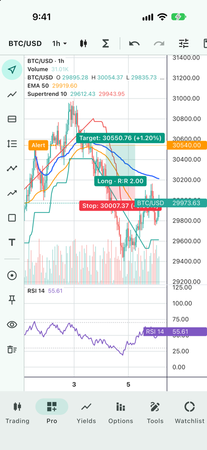
  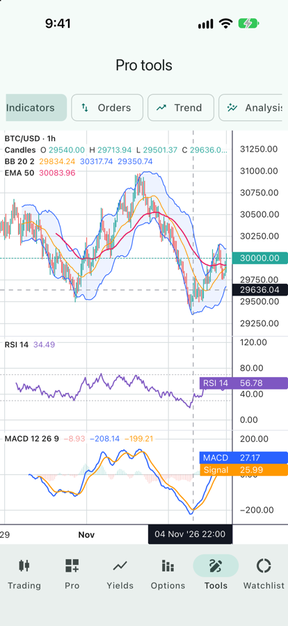
  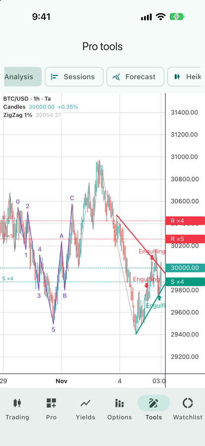
</p>

Each feature below has its own screenshot, all taken from the [example app](#example-app).

## Contents

- [Installation](#installation)
- [Quick start](#quick-start)
- [Features](#features)
- Guide
  - [Pro chart: a ready-made trading screen](#pro-chart-a-ready-made-trading-screen)
  - [Saving and restoring a chart](#saving-and-restoring-a-chart)
  - [Series, panes and scales](#series-panes-and-scales)
  - [Indicators](#indicators)
  - [Technical analysis without a chart](#technical-analysis-without-a-chart)
  - [Legend and tooltip](#legend-and-tooltip)
  - [Drawing tools](#drawing-tools)
  - [Orders, positions and alerts](#orders-positions-and-alerts)
  - [Overlays](#overlays)
  - [Volume profile](#volume-profile)
  - [Forecast fan](#forecast-fan)
  - [Chart types and timeframes](#chart-types-and-timeframes)
  - [Compare symbols](#compare-symbols)
  - [Several charts in step](#several-charts-in-step)
  - [Sparklines and donut charts](#sparklines-and-donut-charts)
  - [Custom series and primitives](#custom-series-and-primitives)
- [Interaction](#interaction)
- [Performance](#performance)
- [Example app](#example-app)
- [Notes](#notes)
- [License & attribution](#license--attribution)

## Installation

```yaml
dependencies:
  swm_chart: ^0.14.0
```

```dart
import 'package:swm_chart/swm_chart.dart';
```

Requires Flutter 3.32 or newer. Runs on iOS, Android, macOS, Windows, Linux
and the web.

## Quick start

```dart
final chart = ChartController(
  options: const ChartOptions(timeScale: TimeScaleOptions(timeVisible: true)),
);

final candles = chart.addCandlestickSeries();
candles.setData([
  CandlestickData(time: 1704067200, open: 100, high: 105, low: 98, close: 103),
  WhitespaceData(time: 1704153600), // a gap
  // ... time is a UTC timestamp in seconds, strictly ascending
]);

// realtime
candles.update(CandlestickData(time: 1704153600, open: 103, high: 104, low: 101, close: 102));

// widget, needs bounded constraints
Expanded(child: SwmChart(controller: chart));

// later
chart.dispose();
```

The API names follow upstream (`addCandlestickSeries`, `setData`, `update`,
`timeScale().fitContent()`, `scrollToRealTime()`, `subscribeCrosshairMove`, …),
so the [upstream docs](https://tradingview.github.io/lightweight-charts/) still apply.

## Features

Everything in Lightweight Charts v5.2.1 that applies to Flutter is ported:

| Area | |
|---|---|
| Series: Candlestick, Bar, Line, Area, Baseline, Histogram, **custom series** | ✅ |
| Whitespace data, line types (simple, stepped, curved monotone) | ✅ |
| Chart types: time (`ChartController()`), **yield curve** (`.yieldCurve`), **options/price axis** (`.options`) | ✅ |
| Multiple panes: stretch factors, draggable separators, add/remove/swap/move, `addDefaultPane` | ✅ |
| Price scales: left, right, overlays (`overlayPriceScales`); normal, log, percentage, indexed-to-100; edge tick marks, ticks | ✅ |
| Time scale: bar spacing, right offset (bars or pixels), fix edges, lock range on resize, uniform distribution, ignore whitespace, conflation | ✅ |
| Crosshair: normal / magnet / magnet OHLC / hidden, per pane, `setCrosshairPosition`, tracking mode | ✅ |
| Last value labels, price line source, custom price lines, base line, last price animation | ✅ |
| Hit testing: `hoveredSeries` / `hoveredObjectId`, `hoveredSeriesOnTop` | ✅ |
| Plugins: primitives API, series markers, up/down markers, text & image watermarks | ✅ |
| Localization: locale, date format, month names, price/percentage/tick mark formatters | ✅ |
| Events: crosshair move, click, double click, visible logical/time range, size, data changed | ✅ |
| Gestures: pan + kinetic, pinch, long-press crosshair, axis drag, double-tap reset, mouse wheel — each switchable like `handleScroll` / `handleScale` | ✅ |
| Desktop / web: crosshair follows the mouse, resize cursors on axes and separators, primitive `cursor` | ✅ |
| Accessibility: `Semantics` label and a summary of the last values | ✅ |
| Attribution logo (opt-in), `takeScreenshot` | ✅ |

Not applicable in Flutter: `autoSize`/`resize`/`width`/`height` (the widget
takes its parent's size), `chartElement`, `colorSpace`, `colorParsers`.

Beyond upstream:

| Area | |
|---|---|
| **Pro chart**: a ready-made screen — top bar (interval, chart type, indicator picker and settings, undo, scales), drawing toolbar, style bar for the selected drawing | ✅ |
| **Save / restore the whole chart** as JSON: chart type, scale, indicators with their inputs and styles, drawings, trading lines; indicator templates | ✅ |
| **73 indicators**, one line each: moving averages, bands and stops, momentum, trend, volume, volatility ([list](#indicators)) | ✅ |
| **Technical analysis** (`Ta`): every indicator as a plain function, plus ZigZag, Elliott waves, support / resistance, chart and candlestick patterns, auto trendlines, divergences, Williams fractals, Fibonacci, pivot points, regression channel, volume profile | ✅ |
| **Legend & tooltip** following the crosshair | ✅ |
| **Drawing tools** (30): lines, channels, pitchforks, Fibonacci retracement / extension / time zones, Gann fan, long / short position, anchored VWAP, regression trend, ranges, shapes, callouts; an editor with undo / redo, duplicate, lock, magnet | ✅ |
| **Trading lines**: draggable orders, TP / SL, positions with P&L, price alerts | ✅ |
| **Overlays**: band fill, price levels, **volume profile** (value area, per session), **forecast fan** | ✅ |
| **Chart types & timeframes**: Heikin-Ashi, Renko, line break, range bars; resample to minutes … months | ✅ |
| **Compare symbols** on a percentage scale | ✅ |
| **Crosshair sync** across charts, symbols and intervals | ✅ |
| **Sparklines** and **donut charts** for lists and dashboards | ✅ |

## Pro chart: a ready-made trading screen

<p>
  
  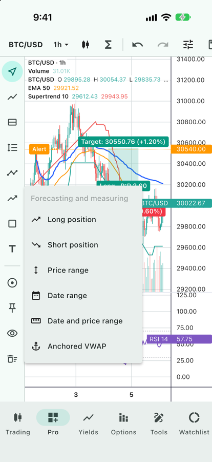
  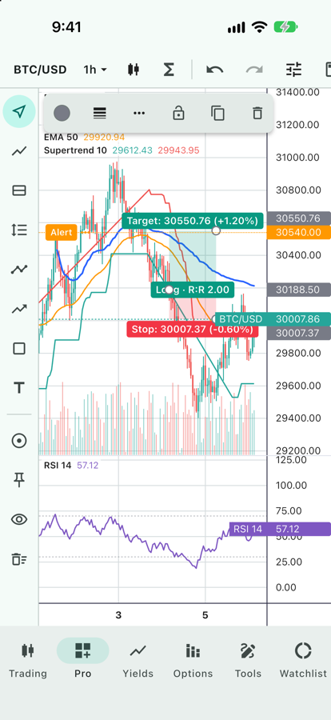
  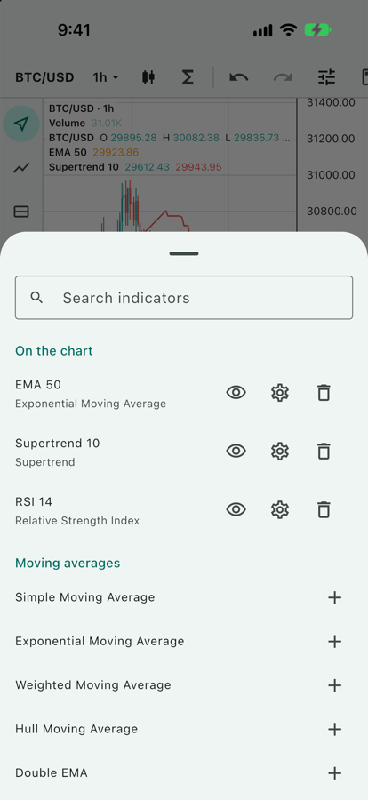
  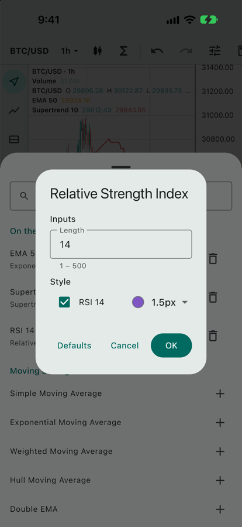
</p>

`SwmProChart` is the whole trading screen in one widget, around a
`ProChartController`:

- **Top bar**: the symbol, the interval, the chart type (candles, hollow
  candles, bars, line, area, baseline, Heikin-Ashi), the indicator picker,
  undo / redo, and log / percent scale and volume.
- **Drawing toolbar** on the left, tools in groups, plus magnet (snap to
  OHLC), keep drawing, hide and remove all.
- **Style bar** over the selected drawing: color, width, line style, text,
  lock, duplicate, delete — each change can be undone.
- **Indicator picker**: the indicators on the chart (show / hide, settings,
  remove) and all 73 to add, searchable. **Settings**: inputs and the color,
  width and visibility of each line.

```dart
final pro = ProChartController(symbol: 'BTC/USD', interval: '1h');
pro.setData(bars, volumes: volumes);
pro.addIndicator(IndicatorCatalog.byId('ema')!, values: {'period': 50});

SwmProChart(
  controller: pro,
  intervals: const ['15m', '1h', '4h', '1D'],
  onIntervalChanged: (i) async => pro.setData(await api.bars('BTC/USD', i)),
  actions: [IconButton(icon: const Icon(Icons.save), onPressed: save)],
)

pro.update(tick); // realtime: price, volume, Heikin-Ashi and indicators
```

The parts are widgets of their own (`ProChartTopBar`, `DrawingToolbar`,
`DrawingStyleBar`, `IndicatorPicker`, `showIndicatorSettings`) to lay out
differently, and `DrawingTools.groups` / `IndicatorCatalog.all` are plain
lists to build your own.

## Saving and restoring a chart

```dart
final saved = jsonEncode(pro.saveState());
// later, after setData:
pro.restoreState(jsonDecode(saved));

// indicators only, as a template for other symbols
final template = pro.saveIndicators();
other.restoreIndicators(template);
```

The state holds the chart type, price scale mode, volume, symbol, interval,
each indicator (its catalog id, inputs, line styles, visibility), the
drawings (anchored by time) and the trading lines — not the bars.

## Series, panes and scales

<p>
  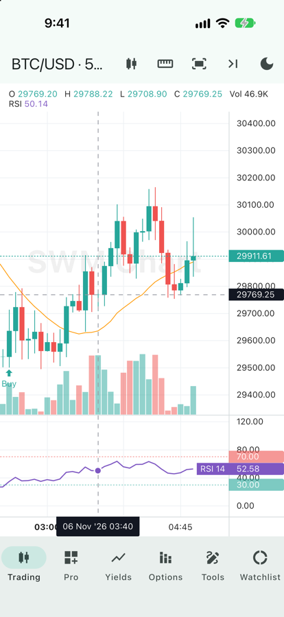
  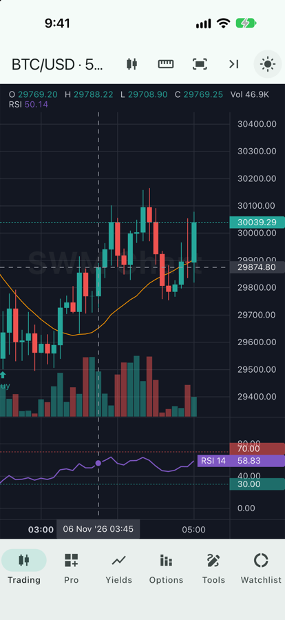
  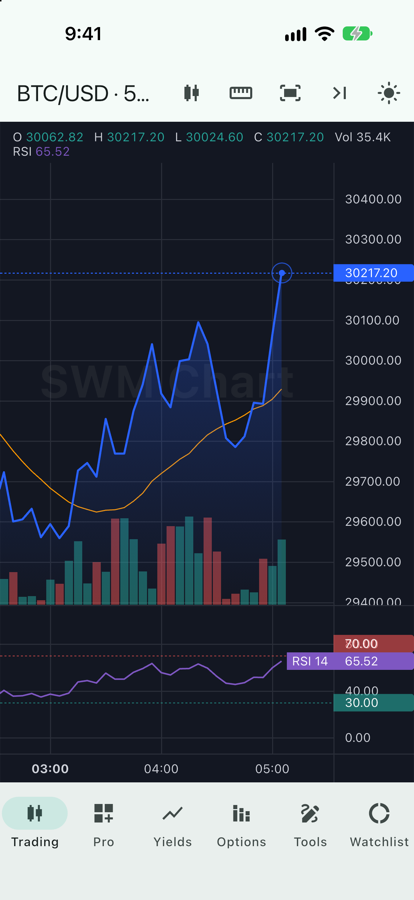
</p>

```dart
// volume on its own scale at the bottom of the pane
final volume = chart.addHistogramSeries(const HistogramSeriesOptions(
  priceScaleId: 'volume',
  priceFormat: PriceFormat.volume(),
));
chart.priceScale('volume').applyOptions(
  const PriceScaleOptions(scaleMargins: ScaleMargins(top: 0.8, bottom: 0)),
);

// RSI in a second pane with 70/30 lines
final rsi = chart.addLineSeries(const LineSeriesOptions(color: Colors.purple), 1);
rsi.createPriceLine(const PriceLineOptions(price: 70, lineStyle: LineStyle.dashed));
rsi.createPriceLine(const PriceLineOptions(price: 30, lineStyle: LineStyle.dashed));
chart.panes()[0].setStretchFactor(3);

// markers
final markers = createSeriesMarkers(candles, [
  SeriesMarker(time: t, position: SeriesMarkerPosition.belowBar,
      shape: SeriesMarkerShape.arrowUp, color: Colors.green, text: 'Buy'),
]);

// watermark
createTextWatermark(chart.panes()[0],
    const TextWatermarkOptions(lines: [TextWatermarkLine(text: 'SWM Chart')]));

// log / percentage scale
chart.priceScale().applyOptions(const PriceScaleOptions(mode: PriceScaleMode.logarithmic));

// load more history when the user scrolls near the first bar
chart.timeScale().subscribeVisibleLogicalRangeChange((range) {
  if (range != null && range.from < 20) { /* fetch older bars, then setData */ }
});
```

Yield curves and options chains:

<p>
  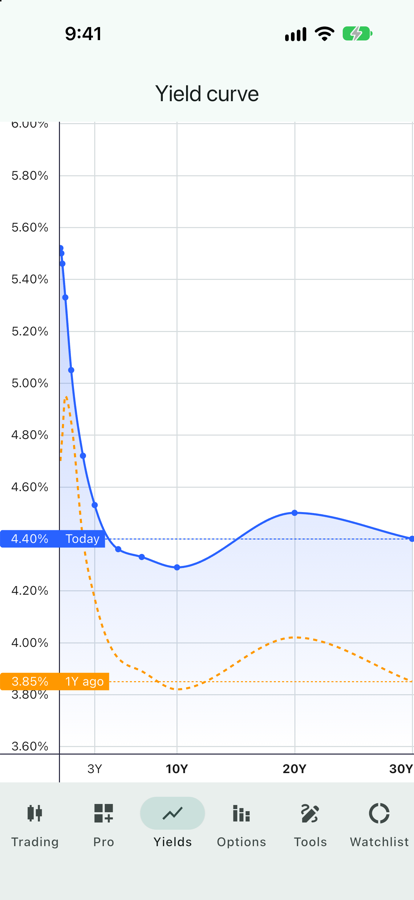
  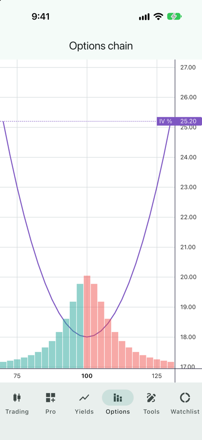
</p>

```dart
final yields = ChartController.yieldCurve(); // time = months
yields.addLineSeries().setData([LineData(time: 3, value: 5.4), LineData(time: 120, value: 4.3)]);

final chain = ChartController.options(precision: 0); // time = strike price
```

## Indicators

<p>
  
  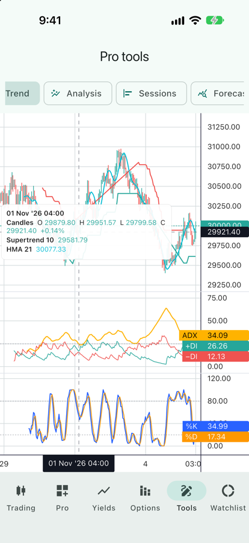
</p>

```dart
chart.addIndicator(Bollinger(), source: candles);          // over the candles
chart.addIndicator(Ema(50), source: candles);
final rsi = chart.addIndicator(Rsi(14), source: candles);   // its own pane, 70 / 30 levels
chart.addIndicator(Macd(), source: candles);
chart.addIndicator(Vwap(), source: candles, volume: volumeSeries);
rsi.remove();
```

73 built in. Overlays go on the price pane, the rest in a pane of their
own with their usual levels:

| Group | Indicators |
|---|---|
| Moving averages | `Sma`, `Ema`, `Wma`, `Hma`, `Dema`, `Tema`, `Rma`, `Vwma`, `Alma`, `Lsma`, `Zlema`, `T3`, `McGinley`, `Kama`, `Envelope`, `Alligator` |
| Bands, clouds, stops | `Bollinger`, `Keltner`, `Donchian`, `Ichimoku` (cloud projected ahead), `Supertrend`, `ParabolicSar`, `ChandelierExit` |
| Momentum | `Rsi`, `StochRsi`, `Stochastic`, `Macd`, `Ppo`, `WilliamsR`, `Cci`, `Roc`, `Momentum`, `Cmo`, `Tsi`, `Trix`, `UltimateOscillator`, `AwesomeOscillator`, `AcceleratorOscillator`, `Dpo`, `Coppock`, `Kst`, `FisherTransform`, `ConnorsRsi`, `Rvi`, `Smi` |
| Trend | `Adx`, `Aroon`, `Vortex`, `ElderRay`, `BalanceOfPower`, `Choppiness`, `MassIndex`, `SineWave`, `EvenBetterSinewave` |
| Volume | `Vwap`, `Obv`, `Mfi`, `Cmf`, `AccumulationDistribution`, `ChaikinOscillator`, `PriceVolumeTrend`, `VolumeIndexes` (NVI / PVI), `Klinger`, `ForceIndex`, `EaseOfMovement`, `VolumeOscillator`, `VolumeSma` |
| Volatility | `Atr`, `StandardDeviation`, `HistoricalVolatility`, `BollingerPercentB`, `BollingerWidth`, `UlcerIndex` |

`Sma`, `Ema`, `Wma`, `Bollinger`, `Rsi`, `Macd`, `Stochastic`, `Atr`,
`Vwap` and `Ichimoku` only recompute the last bar on a tick. Extend
`Indicator` (`lines`, `compute(input, from, out)`) or `TaIndicator`
(`series(bars)`) for your own, or call `computeAll` to use the math
without a chart.

## Technical analysis without a chart

<p>
  
</p>

`Ta` has the same math as plain functions over a list of bars, plus the
analysis tools — for screeners, alerts and backtests:

```dart
final bars = [for (final c in candles) TaPoint(date: c.date, open: c.o, high: c.h, low: c.l, close: c.c, volume: c.v)];
final rsi = Ta.rsi(bars);                        // List<double?>
final zigzag = Ta.zigzag(bars, deviation: 1);    // swings of 1% or more
final waves = Ta.elliottWaves(bars);             // automatic Elliott count
final lines = Ta.autoTrendlines(bars);           // support / resistance trend lines
final levels = Ta.supportResistance(bars);       // support / resistance levels
final patterns = Ta.detectPatterns(bars);        // head & shoulders, triangles, flags…
final candlesticks = Ta.candlePatterns(bars);    // engulfing, doji, hammer…
final bullish = Ta.rsiBullishDivergence(bars);
final hull = Ta.hma(bars, 21);                   // any indicator, as a series
final s = Ta.stochRsi(bars);                     // several lines come as a record: s.k, s.d
final f = Ta.fractals(bars);                     // Williams fractals: f.up, f.down (bar indices)
```

Every result lines up with the bars, `null` through the warm-up. The
Analysis demo in the example app draws them on a chart: the ZigZag as a line
series, the Elliott count as a `PathDrawing`, trend lines as
`TrendLineDrawing`s, levels with `PriceLevelsPrimitive` and candlestick
patterns as markers.

Implement `TaBar` on your own bar class to pass it in directly. Import
`package:swm_chart/ta.dart` for just this part.

## Legend and tooltip

```dart
createLegend(chart, const LegendOptions(title: 'BTC/USD · 1h'));
createLegend(chart, const LegendOptions(mode: LegendMode.tooltip));
```

Rows at the top-left of each pane (OHLC and change for candles, one row per
indicator) follow the crosshair, or show the last bar when it is hidden. In
tooltip mode a box follows the crosshair instead. Prices are shown as prices
even on a percentage scale.
The [Indicators](#indicators) screenshots show both: the legend on the
left, the tooltip on the right.

## Drawing tools

<p>
  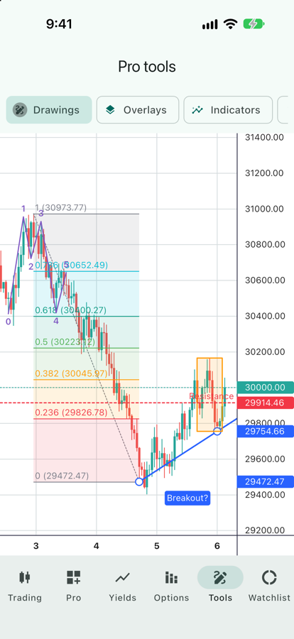
</p>

`DrawingEditor` puts a drawing layer on a pane and edits it with the pointer:

```dart
final editor = DrawingEditor(chart,
    onCreated: (d) => save(d), onChanged: (d) => save(d));

// pick a tool: taps place the anchors, or drag out a two-point tool
editor.tool = (id, anchors) => TrendLineDrawing(id: id, anchors: anchors, extendRight: true);

// without a tool: tap selects, drag moves, drag a handle reshapes
editor.deleteSelected();
```

Built in:

| Group | Drawings |
|---|---|
| Lines | `TrendLineDrawing` (also ray, extended line, arrow), `HorizontalLineDrawing` (line, ray), `VerticalLineDrawing`, `CrossLineDrawing` |
| Channels | `ParallelChannelDrawing`, `RegressionTrendDrawing`, `PitchforkDrawing` (Andrews, Schiff, modified Schiff) |
| Fibonacci, Gann | `FibRetracementDrawing`, `FibExtensionDrawing` (trend-based), `FibTimeZoneDrawing`, `GannFanDrawing` |
| Patterns | `PathDrawing` (Elliott impulse and correction, XABCD, any labels) |
| Forecasting, measuring | `PositionDrawing` (long / short: target, stop, R:R, amounts), `PriceRangeDrawing`, `DateRangeDrawing`, `MeasureDrawing`, `AnchoredVwapDrawing` (with bands) |
| Shapes, text | `RectangleDrawing`, `EllipseDrawing`, `FreehandDrawing`, `TextDrawing`, `CalloutDrawing` |

`AnchoredVwapDrawing` and `RegressionTrendDrawing` read the price series
(`source`); give the codec the same series to load them
(`DrawingCodec(source: candles, volume: volume)`).

**Undo / redo.** `editor.undo()` / `editor.redo()` step through adding,
moving, reshaping and deleting (`canUndo`, `canRedo`, `onHistoryChanged`).
`editor.update(id, (d) => ...)` changes a drawing's style, text or lock as
one undoable step; `editor.duplicate(id)` copies one.

**Save / load.** `DrawingCodec` saves drawings as JSON with the anchors
stored by time, so they stay put when older history is paged in:

```dart
final codec = DrawingCodec();
final saved = jsonEncode(codec.encodeAll(editor.drawings, chart.timeScale().logicalToTime));
// later, once the data is loaded:
editor.layer.drawings = codec.decodeAll(jsonDecode(saved), chart.timeScale().timeToLogical);
```

**Alerts on drawings.** `Drawing.pricesAt(logical)` / `editor.pricesAt(time)`
give a drawing's price(s) at a bar — e.g. to alert when the price crosses a
trend line.

Anchors are a fractional logical index and a price, so drawings can extend
past the last bar. For anything else, extend `Drawing` (`anchorCount`,
`paint`, `hitDistance`). Set `snap` for a magnet, `keepTool` to draw several
in a row, and `TrackingModeOptions(longPressCrosshair: false)` to edit with
long presses.

Lower level: `chart.subscribePointer` offers each drag (and long press) in a
pane to your handler; return `true` on `down` to take it, and the chart
won't scroll. `PaneApi.priceToCoordinate` / `coordinateToPrice` and the
`price` on click events convert between pixels and prices.

## Orders, positions and alerts

<p>
  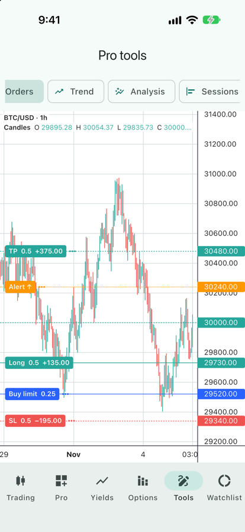
</p>

```dart
final trading = TradingLines(candles,
    onDragEnd: (line) => broker.modify(line.id, line.price),
    onAlert: (alert, price) => notify('${alert.id} at $price'));
trading
  ..add(TradingLine(id: 'pos', kind: TradingLineKind.position, price: 29730, quantity: 0.5))
  ..add(TradingLine(id: 'tp', kind: TradingLineKind.takeProfit, price: 30480, quantity: 0.5))
  ..add(TradingLine(id: 'sl', kind: TradingLineKind.stopLoss, price: 29340, quantity: 0.5))
  ..add(TradingLine(id: 'a1', kind: TradingLineKind.alert, price: 30240));
```

Orders, TP / SL and alerts can be dragged (rounded to the price step);
labels show the quantity and P&L against the position or the last price.
Alerts fire when the last price crosses them (`AlertCondition`).

## Overlays

<p>
  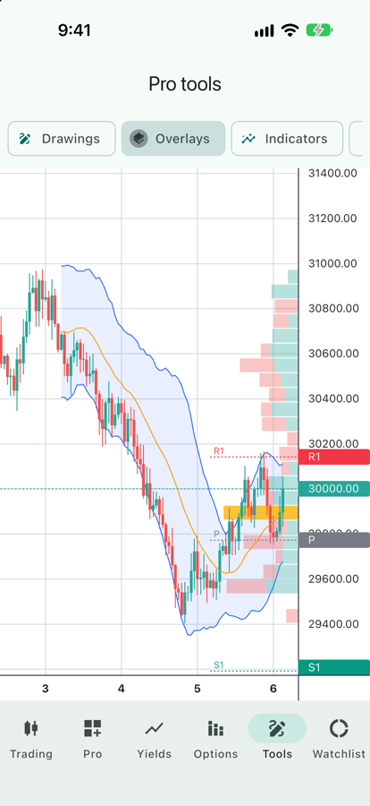
</p>

Primitives attached to a series with `series.attachPrimitive(...)`:

- `BandFillPrimitive`: a filled band between two lines (Bollinger, Keltner,
  an Ichimoku cloud with a second colour where the lines cross).
- `PriceLevelsPrimitive`: pivots, support / resistance, Fibonacci zones,
  with optional axis labels and hit ids.
- `VolumeProfilePrimitive` and `SessionVolumeProfilePrimitive`: see
  [Volume profile](#volume-profile).
- `FanPrimitive`: see [Forecast fan](#forecast-fan).

## Volume profile

<p>
  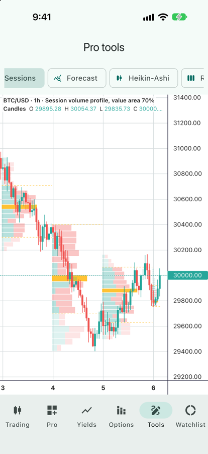
</p>

```dart
final vp = Ta.volumeProfile(bars, buckets: 32);
print('POC ${vp.pocPrice}, value area ${vp.valueAreaLow}–${vp.valueAreaHigh}');

candles.attachPrimitive(VolumeProfilePrimitive(
  bins: [for (final b in vp.buckets)
    VolumeProfileBin(low: b.priceLow, high: b.priceHigh, volume: b.volume, upVolume: b.upVolume)],
  options: const VolumeProfileOptions(valueArea: 0.7), // VAH / VAL dashed, the rest dimmed
));

// one profile per trading day, each over its own bars (intraday data)
final sessions = Ta.sessionVolumeProfiles(bars, buckets: 24);
candles.attachPrimitive(SessionVolumeProfilePrimitive(sessions: [
  for (final s in sessions)
    SessionProfile(from: times[s.from], to: times[s.to], bins: [
      for (final b in s.profile.buckets)
        VolumeProfileBin(low: b.priceLow, high: b.priceHigh, volume: b.volume, upVolume: b.upVolume),
    ]),
]));
```

The value area is the range around the point of control holding 70% of the
volume (`Ta.valueAreaShare`), grown toward the busier side one row at a
time; `Ta.valueArea(volumes, poc)` computes it for any profile. Sessions are
calendar days by default — pass `sessionOf` for anything else. To follow the
bars on screen, refit the bins in `subscribeVisibleLogicalRangeChange`.

## Forecast fan

<p>
  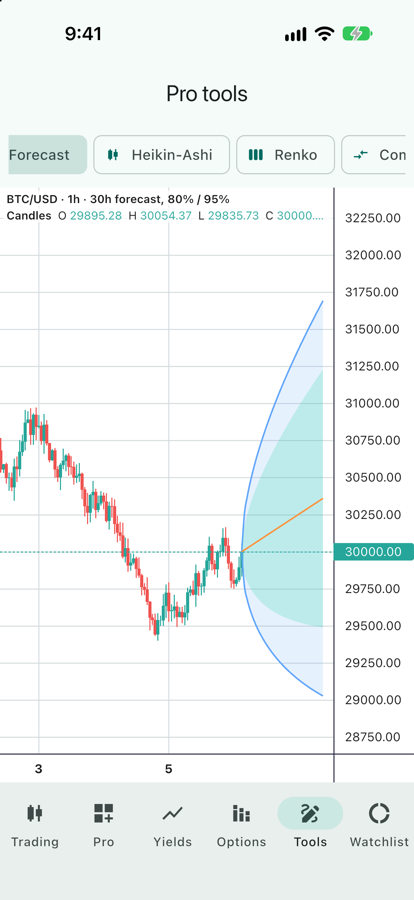
</p>

```dart
final fan = FanPrimitive(
  anchorTime: last.time,
  anchorValue: last.close,
  steps: [for (final s in forecast)
    FanStep(mid: s.mid, ranges: [(s.lo80, s.hi80), (s.lo95, s.hi95)])],
);
candles.attachPrimitive(fan);
chart.timeScale().applyOptions(const TimeScaleOptions(rightOffset: 20)); // room ahead
```

Steps sit on the logical index past the last bar, so no whitespace data is
needed; the ranges take part in autoscale.

## Chart types and timeframes

<p>
  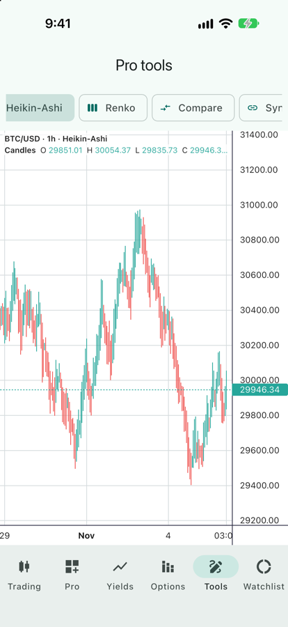
  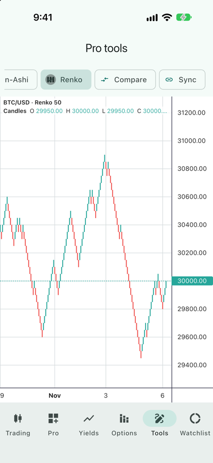
</p>

```dart
candles.setData(heikinAshi(bars));
candles.setData(renko(bars, boxSize: 50));   // also lineBreak, rangeBars
final hourly = resample(minuteBars, const Timeframe.hours(1));   // .weeks(), .months()
final live = Resampler(const Timeframe.minutes(15));
candles.update(live.add(tick));                  // streaming
```

## Compare symbols

<p>
  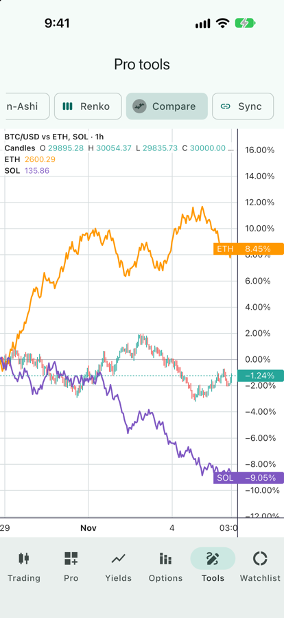
</p>

```dart
chart.addComparison(ethBars, title: 'ETH');   // switches the scale to %
chart.addComparison(solBars, title: 'SOL');
```

Removing the last comparison (`removeComparison`) restores the scale mode.

## Several charts in step

<p>
  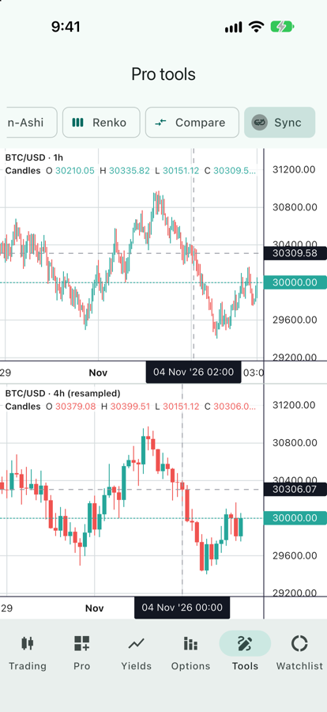
</p>

```dart
final sync = CrosshairSync([(hourlyChart, hourlyCandles), (fourHourChart, fourHourCandles)]);
// …
sync.dispose();
```

Pointing at a moment on one chart moves every other chart's crosshair to the
same time — across symbols, and across intervals: on a 4h chart it lands on
the bar holding that hour. `timeScale().timeToLogical` / `logicalToTime`
convert between times and fractional bar indices, between bars and past them.

## Sparklines and donut charts

<p>
  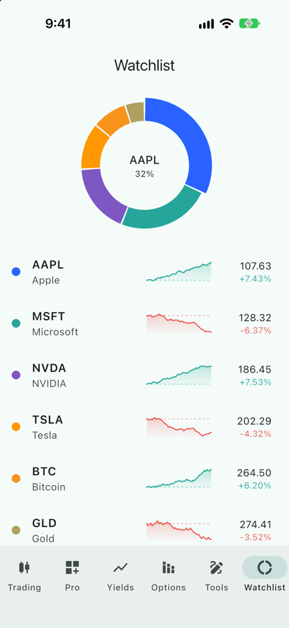
</p>

For list rows and cards, `SwmSparkline` draws a small line without a chart
engine behind it — no axes, scales or gestures:

```dart
SwmSparkline(
  values: closes,          // oldest first; non-finite values are skipped
  width: 80,
  height: 32,
  baseline: previousClose, // optional dashed reference; decides green / red
  curved: true,
)
```

`SwmSparklinePainter` paints the same line onto any `Canvas`, e.g. into an
image with a `PictureRecorder`.

`SwmDonut` shows shares of a whole, e.g. a portfolio's allocation:

```dart
SwmDonut(
  slices: [
    for (final h in holdings) SwmDonutSlice(value: h.value, color: h.color),
  ],
  size: 130,
  innerRadius: 38,
  thickness: 30,
  selected: touched,                       // drawn thicker
  onSelect: (i) => setState(() => touched = i), // null on release
  center: Text(touched == null ? 'Total' : holdings[touched!].symbol),
)
```

## Custom series and primitives

Custom series: implement `CustomSeriesView<T>` (`priceValues`, `draw`) and
add it with `chart.addCustomSeries(view)`.

Custom drawings: extend `ChartPrimitive` (override `paint`, `priceAxisLabels`,
`timeAxisLabels`, `autoscaleInfo`, `hitTest`) and attach it with
`series.attachPrimitive(...)` or `pane.attachPrimitive(...)`. The paint
context gives the crosshair's bar (`crosshairIndex`) and position.

## Interaction

| | Touch | Mouse |
|---|---|---|
| Crosshair | tap to show / hide, then drag to move it; or long-press and move | follows the pointer |
| Scroll / zoom | drag (locked to its main direction), pinch | drag, wheel |
| Scale an axis | drag it; double-tap resets | drag it; double-click resets |
| Resize panes | drag the separator | drag the separator (`resizeRow` cursor) |

## Performance

Frame times in profile mode with 100k candles plus 100k volume columns
(`example/integration_test/perf_test.dart`):

| Scenario | iPhone build / raster (avg, ms) | macOS build / raster (avg, ms) |
|---|---|---|
| Scroll at normal zoom | 1.9 / 1.4 | 1.0 / 1.2 |
| Realtime update every frame | 2.1 / 1.9 | 1.3 / 1.7 |
| Crosshair moving | 1.9 / 2.3 | 0.6 / 0.9 |
| All 100k visible, conflation on | 2.4 / 2.1 | 1.1 / 1.2 |
| All 100k visible, conflation off | 28.7 / 16.9 | 16 / 8 |

The chart paints in two layers: a crosshair move or the last price pulse
repaints only the overlay (crosshair, legend, trading lines, drawings), not
the series.

When users can zoom out over tens of thousands of bars, turn on
`TimeScaleOptions(enableConflation: true)` (optionally with
`precomputeConflationOnInit`), as upstream recommends.

Run the benchmark yourself:

```sh
cd example
flutter drive --profile -d <device> \
  --driver=test_driver/perf_driver.dart --target=integration_test/perf_test.dart
```

## Example app

`example/` has six tabs:

- **Trading**: switchable series types, volume, SMA, an RSI pane with
  buy/sell markers, a watermark, live updates, an OHLC legend, history
  lazy-loading, log/percentage scales, dark mode.
- **Pro**: `SwmProChart` with live ticks, four intervals, and buttons that
  save the whole chart to JSON and restore it.
- **Yields** and **Options**: the two non-time chart types.
- **Pro tools**: drawings, overlays, indicators, orders, trend indicators
  with a tooltip, technical analysis, session volume profiles, a forecast
  fan, Heikin-Ashi, Renko, compare and synced 1h / 4h charts.
- **Watchlist**: sparklines and a donut.

```sh
cd example && flutter run
```

Every screenshot in this README comes from it: `tool/screenshots.sh <simulator-udid>`.

## Notes

- `time` is a `num`: UTC seconds on time charts, months on yield curves,
  prices on options charts. `series.data()` returns values and whitespace.
- Labels use the UTC components of `time`. To show exchange-local time, shift
  the timestamps or pass `LocalizationOptions.timeFormatter` /
  `TimeScaleOptions.tickMarkFormatter`.
- Inside a vertical `ListView`, vertical drags go to the list; set
  `handleScroll: HandleScrollOptions(vertTouchDrag: false)` so the chart never
  claims them.
- `SwmChart(semanticsLabel: ...)` names the chart for screen readers; its
  value lists each series' last value.
- `SeriesOptions` are generated by `tool/gen_series_options.py`; edit the
  script, not `lib/src/series_options.dart`.

## License & attribution

Apache License 2.0 (see `LICENSE` and `NOTICE`). The code is derived from
TradingView Lightweight Charts™. Upstream's NOTICE requires apps that use it
to show attribution to TradingView with a link to
https://www.tradingview.com/, e.g. on an About screen. The chart can show
the TradingView logo for you (`layout.attributionLogo: true`, off by default;
pass `SwmChart(onAttributionLogoTap: ...)` to open the link).
